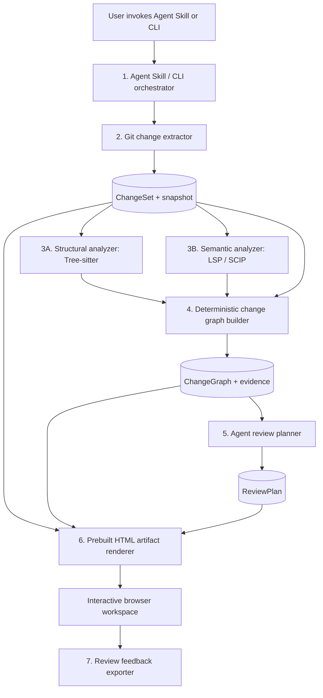

# Better Code Review (`$better-code-review`)

**Product concept, architecture, research landscape, and development reference**  
**Status:** Consolidated design discussion — not a finalized technical specification  
**Prepared:** October 16, 2026  
**Intended audience:** Maintainers, contributors, engineering/design agents, and anyone conducting deeper design or implementation work

> **One-sentence vision:** Turn a PR, commit, commit range, or local Git changes into an interactive, dependency-aware review workspace that organizes code changes by their logic and relationships—not merely by file order.

> **Core principle:** Code-analysis tools establish what changed and what relationships can be verified. An AI agent proposes what those changes mean and how to review them. A human inspects, challenges, comments on, and ultimately judges the result.

---

## Table of contents

1. [Purpose and document conventions](#1-purpose-and-document-conventions)
2. [Problem statement and motivation](#2-problem-statement-and-motivation)
3. [Product vision, scope, and principles](#3-product-vision-scope-and-principles)
4. [User workflows and entry points](#4-user-workflows-and-entry-points)
5. [Worked examples and review organization](#5-worked-examples-and-review-organization)
6. [Review workspace: UX and interactions](#6-review-workspace-ux-and-interactions)
7. [High-level architecture](#7-high-level-architecture)
8. [Component-by-component architecture and data flow](#8-component-by-component-architecture-and-data-flow)
9. [Canonical data model and contracts](#9-canonical-data-model-and-contracts)
10. [Language-agnostic analysis strategy](#10-language-agnostic-analysis-strategy)
11. [Agent skill, orchestration, and model boundaries](#11-agent-skill-orchestration-and-model-boundaries)
12. [HTML artifact, comments, and feedback loop](#12-html-artifact-comments-and-feedback-loop)
13. [Correctness, completeness, and trust](#13-correctness-completeness-and-trust)
14. [Performance, security, privacy, and portability](#14-performance-security-privacy-and-portability)
15. [Open-source organization and potential stack](#15-open-source-organization-and-potential-stack)
16. [Existing tools and differentiation](#16-existing-tools-and-differentiation)
17. [MVP, milestones, and development roadmap](#17-mvp-milestones-and-development-roadmap)
18. [Evaluation and validation plan](#18-evaluation-and-validation-plan)
19. [Decisions, recommendations, and open questions](#19-decisions-recommendations-and-open-questions)
20. [Appendix: illustrative end-to-end example](#20-appendix-illustrative-end-to-end-example)
21. [Further reading and research leads](#21-further-reading-and-research-leads)

---

## 1. Purpose and document conventions

This document captures the complete direction developed across the brainstorming conversations about **Better Code Review**. It is meant to be a durable starting point for deeper product design, technical architecture, interface design, implementation planning, and future issue creation. It covers the initial problem and product idea, subsequent decisions about an agent-skill interface and HTML output, multilingual analysis options, a detailed data-flow architecture, competitive context, and unresolved questions.

### Status terminology

The conversation included both explicit user preferences and proposed implementation choices. They should not be mistaken for equally settled decisions:

- **Product requirement / expressed intent:** The user specifically described or requested this behavior.
- **Recommended approach:** A proposal discussed as a good direction, but still subject to design/technical validation.
- **Possible extension:** A feature intentionally deferred beyond the initial product.
- **Open question:** No definitive decision has been made.

Examples, interfaces, counts, and diagrams are illustrative unless explicitly labeled as requirements. Referenced external projects were identified during earlier research discussions; names, API details, licenses, installation commands, project maturity, and availability should be independently rechecked when making dependencies or claims in a public README.

---

## 2. Problem statement and motivation

### 2.1 The shift toward agent-written code

Coding agents can now implement changes spanning many functions, modules, packages, and files. A developer may prompt an agent to implement a feature, refactor an API, fix a bug, or adjust behavior, then inspect a generated PR or local diff. The developer still needs to understand the implementation and verify its correctness, but the volume and distribution of edits can make ordinary diff review difficult.

Traditional review interfaces usually organize changes by **files and hunks**. The natural way people understand software behavior is frequently through **relationships and causal/functional flow**:

- What is the central change?
- What downstream code was modified because of it?
- Which callers, interfaces, schemas, or tests were affected?
- Why did a particular edit occur?
- Was every necessary propagation completed?
- Does the implementation satisfy the feature intent?
- Which meaningful changes have I actually reviewed?

A file-by-file list obscures these relationships. Reviewers must mentally reconstruct them while repeatedly navigating between files.

### 2.2 Founding example: one signature change, ten callers

An agent adds a new parameter to a function and updates ten callers in separate files. A normal diff might display eleven files alphabetically or in repository order; the defining signature change could be buried midway through the list. The reviewer has to discover which edit is the root and why other edits exist.

The proposed alternative shows the **changed function contract first** and then **connected downstream caller changes**. The reviewer can expand the root change, follow connections to caller edits, inspect code, and verify whether any caller was missed.

The visualization might resemble:

```text
                   [formatPrice(amount, currency)]
                             │
            change-propagation relationships
                  ┌──────────┼──────────┐
                  ▼          ▼          ▼
              [Checkout]  [Invoices]  [Other callers]
                  │          │          │
              [diffs]     [diffs]    [expand 8 more]
                             │
                          [Tests]
```

**Crucial semantic distinction:** A verified call edge normally points from caller to callee. An arrow in a **change-propagation view** may intentionally point from the changed callee outward to affected callers. The two edge meanings should never be conflated in the data model or UI.

### 2.3 Generalized problem

The goal is not merely to summarize a diff with AI. It is to change the effective unit of human review from **file/hunk** to a **logical code change with its causes, consequences, dependencies, and verification evidence**.

A more helpful review representation should let a developer reconstruct the implementation with less unnecessary navigation while retaining direct access to all original code and changes.

---

## 3. Product vision, scope, and principles

### 3.1 Product positioning

**Name:** Better Code Review  
**Proposed skill invocation:** `$better-code-review`  
**Distribution intent:** Open source  
**Context:** Any code change, whether human- or agent-written. Agent-written code is the motivating case: as agents write most code, review becomes the bottleneck.

Possible description:

> Better Code Review turns any Git diff into an interactive, dependency-aware code-review workspace. Explore logical change groups, trace code relationships, inspect real diffs, and leave feedback for your coding agent.

### 3.2 Intended outputs

The principal user-facing output is an **interactive HTML artifact**, potentially fully self-contained, which a developer can open in a browser. It should support:

- Graph-based visualization of connected logical changes.
- Dragging, panning, zooming, expanding, and collapsing graph nodes.
- Opening complete, authentic code diffs in or alongside nodes.
- Viewing a guided review sequence rather than only a freeform canvas.
- Adding comments anchored to actual code.
- Marking review progress.
- Exporting review feedback for an agent to act on.
- Switching to the familiar file-by-file diff as a trustworthy fallback.

The HTML is a **review workspace**, not simply a static infographic or AI-written prose summary.

### 3.3 Foundational product principles

1. **Human-centered logical organization:** Present the core change and its effects in a comprehensible sequence.
2. **Evidence before explanation:** Every displayed change must be grounded in the real source diff; verifiable code relationships should cite machine-derived evidence.
3. **Keep inference distinct from fact:** Separate static symbol relationships from agent-inferred change causality or architectural relationships.
4. **Complete diff coverage:** Every source hunk must remain accessible and accounted for, including unsupported languages, configuration files, and ungrouped edits.
5. **Local-first and privacy-conscious:** Do not require a hosted review service or an account; no telemetry by default. Code sent to an agent/model remains governed by the selected agent/provider.
6. **Agent-friendly, agent-independent engine:** Make invocation easy through an Agent Skill, but make the CLI, analysis, schemas, and renderer usable independently.
7. **Language-agnostic core:** Use common parsers, protocols, and indexes instead of designing a separate review product for each language.
8. **Deterministic rendering:** Do not ask the model to regenerate arbitrary HTML/JavaScript for every review.
9. **Graceful degradation:** A repository lacking language-server support should still produce a usable Git-based review artifact.
10. **Reviewer control:** A suggested order must not prevent reviewers from navigating freely, reorganizing nodes, or inspecting unexplained edits.

### 3.4 Initial non-goals / deliberately deferred capabilities

Recommendations discussed for the MVP include **not** prioritizing:

- Replacing GitHub's entire PR and approval system.
- Hosting a SaaS backend or requiring user accounts.
- Automatic bug detection as the product's primary proposition.
- Perfect call graphs for all languages and frameworks.
- Repository-wide exhaustive indexing on every invocation.
- Real-time bidirectional communication with the agent.
- Automatic posting of comments to GitHub.
- A universal layout algorithm that is optimal for every PR.
- Full analysis of all dynamic, reflective, network-based, or cross-service relationships.

These may become useful later, but the first objective is a trustworthy and useful *representation* of changes.

---

## 4. User workflows and entry points

### 4.1 Natural skill commands

The user envisions invoking the skill inside an existing coding-agent environment:

```text
$better-code-review PR <PR number>
$better-code-review commit <hash>
$better-code-review my local changes
```

Proposed normalized forms:

```text
$better-code-review pr 123
$better-code-review commit a3f92c1
$better-code-review local
$better-code-review range main..feature
```

The precise syntax and availability of a `$skill` invocation will depend on the agent client; the skill should follow applicable Agent Skills conventions and support natural-language variants.

### 4.2 Independent CLI commands

An independently callable CLI was recommended so the tool isn't coupled to a specific agent:

```bash
better-code-review generate --pr 123
better-code-review generate --commit a3f92c1
better-code-review generate --local
better-code-review generate --range main..feature
```

The skill can call this CLI. The same engine can also run from a terminal or later from editor integrations and CI.

### 4.3 Typical end-to-end journey

1. The user asks a coding agent to implement a change.
2. The agent edits the repository and finishes.
3. The user invokes `$better-code-review local` (or points it at a PR/commit/range).
4. The skill resolves the target and invokes the analysis tool.
5. The tool captures an exact snapshot of the changes.
6. Structural and semantic analyzers identify modified symbols and relationships.
7. A deterministic graph builder constructs an evidence-backed change graph.
8. The agent proposes logical groups, explanations, and a recommended reading order.
9. A prebuilt renderer generates the HTML artifact.
10. The user opens it, explores connected changes, reads code, adds comments, and marks progress.
11. The user exports feedback and asks the coding agent to address it.
12. The agent edits the code; a new review snapshot can be generated.

### 4.4 Supported change sources

- **Pull request:** Resolve the appropriate base and head revisions; for a typical PR, compare relative to the merge base as appropriate to the intended PR diff.
- **Single commit:** Compare the commit with its selected parent; merge commits require explicit parent/diff semantics.
- **Commit range:** Compare specified revisions or ref range with clear semantics (two-dot vs three-dot/merge base).
- **Local changes:** Capture staged and unstaged changes, and relevant untracked files, without silently ignoring them.

**Snapshot stability matters.** Local working trees may change while analysis is in progress. The tool should operate against a consistent captured snapshot and label the produced review with a snapshot ID so comments do not silently drift to unrelated code.

---

## 5. Worked examples and review organization

### 5.1 Example A — Function parameter propagation

Before:

```typescript
function formatPrice(amount: number) { /* ... */ }
```

After:

```typescript
function formatPrice(amount: number, currency: string) { /* ... */ }
```

Ten caller sites and several tests are adjusted. A natural review order is:

1. Inspect the function's old and new contract and implementation.
2. Examine callers updated to supply the new parameter.
3. Verify that currency values are semantically correct at each call site (e.g., not incorrectly hardcoded).
4. Inspect tests and behavior changes.
5. Examine **unchanged callers/references** that might have needed updates.

The unchanged-caller capability is significant: the tool should not merely report what changed but should help reviewers investigate potentially missing propagation. However, a static analysis result is evidence, **not a guarantee** that all dynamically reachable callers have been found.

### 5.2 Example B — New cancellation endpoint

A feature touches routing, validation, business logic, persistence, events, and tests. The most useful order may be:

1. New or updated API contract.
2. Core cancellation behavior and business rules.
3. Persistence, credits/refunds, and side effects.
4. Integration points and upstream/downstream callers.
5. Tests and verification evidence.

This sequence is **not** necessarily call-graph order. It is a conceptual *implementation-flow* reading order.

### 5.3 Multiple meaningful review orientations

At least two complementary organizational views were identified:

- **Implementation flow:** How does this feature or behavior work, end to end?
- **Change propagation:** What central change caused downstream edits, and what else might need updating?

Potential future modes include architectural flow, execution/data flow, dependency direction, test/coverage orientation, and risk-first review.

There should **not** be a universal, hardcoded top-to-bottom ordering for every PR. The tool can suggest one or several and let the reviewer navigate freely.

### 5.4 Hierarchical grouping

An unresolved but promising design direction is to support **both** high-level conceptual groups and low-level relationships:

```text
Authentication flow (conceptual change group)
  ├── API contract change
  │     └── Specific function/method diff
  ├── Token validation change
  │     ├── Helper change
  │     └── Caller changes
  └── Tests
```

At different zoom/expansion levels, nodes could represent a logical change, cluster, function/method, or individual hunk. Relationships can connect nodes across group boundaries.

---

## 6. Review workspace: UX and interactions

### 6.1 Two complementary primary views

**Graph view** — The signature feature. An interactive network of change nodes connected by evidence-backed or explicitly inferred relationships. The user can pan, zoom, drag, expand/collapse, and selectively open real diffs. The display should prefer a comprehensible overview to a giant spaghetti graph.

**Guided review view** — A suggested linear or hierarchical outline of logical groups. This is important for substantial code reading: a force-directed canvas with hundreds of diff lines is not necessarily a good reading surface. Switching between views should preserve selections, comments, and progress.

**Original file view** — An accessible, familiar file-by-file diff for fallback, auditability, and completeness verification.

### 6.2 Proposed desktop layout

```text
┌──────────────────────────────────────────────────────────────────────────────┐
│ Better Code Review · PR #123 · snapshot abc... · coverage / review progress  │
├─────────────────────┬────────────────────────────────┬───────────────────────┤
│ Review outline      │ Interactive graph canvas       │ Selected change/diff  │
│                     │                                │                       │
│ 1. Core contract    │          [Root change]         │ pricing.ts            │
│ 2. Caller updates   │             /   \              │ - old signature       │
│ 3. Tests            │      [Callers] [Tests]          │ + new signature       │
│                     │                                │                       │
│ Unreviewed: ...     │ pan / zoom / drag / expand     │ Comments / status     │
└─────────────────────┴────────────────────────────────┴───────────────────────┘
```

This is not a fixed requirement. The center canvas should be able to expand significantly, and diffs should be expandable **inline in graph nodes**, not restricted to a narrow side panel.

### 6.3 Proposed interaction inventory

**MVP priorities:**

- Pan, zoom, and drag nodes.
- Expand and collapse clusters and nodes.
- Inspect authentic code diffs and surrounding context.
- Navigate edges between related changes.
- Switch between graph, guided, and file-based views.
- Leave comments on specific code lines/ranges.
- See review progress and hunk-coverage indicators.
- Read concise AI-generated explanations with links to code evidence.
- Export feedback.

**Potential later features:**

- Several automatically proposed reading orders.
- Search/filter by affected symbol, component, risk, file, or relationship type.
- GitHub review-comment synchronization.
- Ask the agent a question directly from a selected graph node.
- Dynamic graph enrichment based on follow-up investigation.
- Local-server-backed persistence and live updates.
- Review history and between-snapshot comparison.

### 6.4 Graph usability constraints

- Default to **collapsed clusters** with meaningful titles.
- Avoid showing every call/reference edge at once.
- Expand related branches only on demand.
- Offer automated layout plus manual drag rearrangement.
- Support automatic re-layout after expand/collapse.
- Visually distinguish call relationships from inferred change propagation.
- Make evidence and relationship direction available on hover/click.
- Represent unchanged but potentially affected entities as *context* rather than pretending they are changed diffs.
- Ensure navigation works without requiring users to understand the entire graph at once.
- Keep actual code and real hunks directly inspectable at all times.

---

## 7. High-level architecture

The proposed architecture separates **orchestration**, **fact extraction**, **relationship construction**, **AI interpretation**, **presentation**, and **feedback**.



The diagram presents the core pipeline linearly for clarity. An eventual implementation should support **incremental enrichment**: additional static evidence, agent investigation, or reviewer questions can add derived information without discarding the original immutable snapshot.

### Main data contracts

| Stage | Primary input | Primary output | Responsibility |
|---|---|---|---|
| Skill / CLI | Natural invocation or CLI arguments | `ReviewRequest` | Interpret target and orchestrate work |
| Git extractor | Repo + revisions/local state | `ChangeSet` | Capture exact before/after data and hunks |
| Structural analyzer | `ChangeSet` + both file versions | `StructuralChangeSet` | Find changed code entities |
| Semantic analyzer | Snapshot + symbols + LSP/SCIP capability | `SemanticEvidence` | Resolve definitions, references, calls, implementations |
| Graph builder | `ChangeSet` + structural + semantic results | `ChangeGraph` | Normalize and connect changed entities |
| Agent review planner | `ChangeGraph` + relevant diffs/context | `ReviewPlan` | Propose conceptual groups, explanations, reading order |
| HTML renderer | Change set + graph + validated plan | `review.html` | Present consistent interactive review |
| Feedback exporter | Browser comments + anchor metadata | `ReviewFeedback` | Return actionable reviewer comments |

---

## 8. Component-by-component architecture and data flow

### 8.1 Component 1 — Agent Skill / CLI

**Purpose:** Resolve user intent and coordinate the workflow. It should not contain most of the code-analysis logic.

**Inputs:** Skill command (`pr`, `commit`, `local`, `range`), repository location, options, and optional instructions/requirements.

**Responsibilities:**

- Resolve PR metadata and revisions (using available Git/provider tooling).
- Validate repository and requested target.
- Choose output location and analysis settings.
- Invoke deterministic extraction/analysis.
- Make relevant source evidence available to the agent review planner.
- Invoke schema validation and rendering.
- Report the artifact path to the user and optionally open it.

**Output:** `ReviewRequest`, followed by orchestrated files/artifacts.

**Design note:** A standalone CLI should work in a no-AI or limited-AI mode, potentially using only deterministic clustering and an ungrouped/fallback representation. The Agent Skill adds richer interpretation but is not a hard dependency of the renderer.

### 8.2 Component 2 — Git Change Extractor

**Purpose:** Establish the authoritative changes and an exact, stable review snapshot. This component is language-independent.

**Input:** `ReviewRequest` and repository state.

**Processing:**

- Resolve base/head semantics precisely.
- Capture original and updated file contents for affected paths where available.
- Enumerate added/modified/deleted/renamed files, binary files, and untracked files.
- Preserve raw patch hunks, hunk IDs, old/new line mappings, and file metadata.
- Include meaningful changes outside supported programming languages.
- Detect and handle snapshots that change during extraction.

**Output:** `ChangeSet` with immutable `snapshotId` and all changed hunks.

**Example:** 11 files, 14 hunks: one `formatPrice` signature edit, ten caller edits, three test edits.

**Important edge cases:** Merge commits, rename detection, missing history/shallow clones, staged plus unstaged interactions, untracked files, generated or huge files, binary assets, file deletions, and symlink handling. These need explicit semantics rather than accidental defaults.

### 8.3 Component 3A — Structural Analyzer

**Purpose:** Answer **what syntactic code structures changed?**

**Input:** `ChangeSet`, before/after contents, and diff line ranges.

**Technology:** Tree-sitter plus available language grammars and symbol-extraction queries; possibly a language pack.

**Processing:**

- Parse before and after versions into syntax trees.
- Identify functions, methods, classes, imports, tests, and other entities overlapping changed hunks.
- Attribute hunks to their containing entities, preserving exact source locations.
- Compare entity versions to characterize syntactic changes where reliable.
- Return generic hunk/file nodes if a structure cannot be recognized.

**Output:** `StructuralChangeSet`, e.g. `pricing.ts::formatPrice` modified; `checkout.ts::renderCheckout` modified; `pricing.test.ts::testFormatting` modified.

**Boundary:** Parsing a `call_expression` named `formatPrice` does **not** necessarily prove which `formatPrice` definition is called. The Tree-sitter grammar and generic query capabilities also vary by language, so broad parsing support is not equal to identical symbol-analysis quality.

### 8.4 Component 3B — Semantic Analyzer

**Purpose:** Answer **how are code symbols related across the repository?**

**Input:** Snapshot/workspace, structural entities, source locations, and whichever LSP/SCIP services are available.

**Relevant LSP operations:**

- `textDocument/documentSymbol` — enumerate symbols in a file.
- `textDocument/definition` — navigate to a referenced definition.
- `textDocument/references` — locate references to a symbol.
- `textDocument/implementation` — find implementations.
- `textDocument/prepareCallHierarchy` — prepare a call-hierarchy item.
- `callHierarchy/incomingCalls` — find callers where supported.
- `callHierarchy/outgoingCalls` — find calls made by a function where supported.

**Processing:**

- Query reference/definition relationships for changed symbols.
- Associate reference sites with their enclosing syntactic entities.
- Intersect symbol references with changed and unchanged locations.
- Consider both **before** and **after** versions: deleted/replaced calls may disappear from the head snapshot.
- Normalize LSP/SCIP outputs into common references and evidence records.
- Capture missing capabilities/analysis errors rather than treating them as evidence of no relationships.

**Output:** `SemanticEvidence` with resolved symbol edges, precise locations, provider information, and support/coverage metadata.

**Boundary:** Not every reference is a call. Not every language server supports call hierarchy. Dynamic dispatch, reflection, macros, generated code, and framework conventions may evade static resolution.

### 8.5 Component 4 — Deterministic Change Graph Builder

**Purpose:** Convert independent structural changes into a language-neutral graph connected by known code relationships.

**Inputs:** `ChangeSet`, `StructuralChangeSet`, and `SemanticEvidence`.

**Processing:**

- Create nodes for changed symbols/functions/methods/classes or, when needed, files and raw hunks.
- Preserve stable mappings from nodes to actual Git hunks and before/after source ranges.
- Add edges for verified relationships such as `calls`, `references`, and `implements`.
- Retain source evidence for every relationship, including provider and locations.
- Add contextual nodes for relevant **unchanged** references/callers where beneficial.
- Track coverage and list any hunk not mapped to a semantic node.
- Keep code direction separate from change-propagation or causal hypotheses.

**Output:** `ChangeGraph` containing nodes, edges, evidence references, and explicit ungrouped/uncovered hunks.

**Boundary:** This deterministic builder should not claim that a reference change occurred *because of* another edit. It knows proven structural relationships; change causality belongs in the inferred layer.

### 8.6 Component 5 — Agent Review Planner

**Purpose:** Answer **what do these connected changes mean, and how should a human review them?**

**Inputs:** `ChangeGraph`, actual relevant diffs, PR description, optional user requirement, and source context requested selectively by the agent.

**Processing:**

- Infer the implementation intent and identify central vs supporting changes.
- Propose conceptual group titles and summaries.
- Group related edits into an understandable hierarchy or sequence.
- Suggest a review ordering appropriate to the change (implementation flow or propagation).
- Identify relationships that are logically related but not statically proven.
- Explain why groups/nodes are connected, citing code evidence when available.
- Potentially flag ambiguous or suspicious propagation for human attention without claiming automatic correctness guarantees.

**Output:** `ReviewPlan`: groups, summaries, primary/supporting node IDs, reading order, optional inferred relationships, and evidence references.

**Validation:** A deterministic validator must reject nonexistent IDs, ensure all real hunks are visible somewhere, label unsupported claims as inference, and avoid accepting fabricated code lines or changed entities. Groups may legitimately overlap, but coverage accounting must remain unambiguous.

**Optimization:** Do not automatically send the entire repository to an LLM. Start with structured deltas and graph summaries, then retrieve additional code context on demand.

### 8.7 Component 6 — HTML Artifact Generator / Viewer

**Purpose:** Present a stable interactive UI generated from structured data rather than from raw AI-written HTML/JavaScript.

**Inputs:** `ChangeSet` + `ChangeGraph` + validated `ReviewPlan`.

**Processing:**

- Load data into a prebuilt application (e.g., React).
- Determine initial graph layout and collapsed groups.
- Render nodes, relationship edges, authentic diffs, guidance, and controls.
- Provide user-controlled navigation, comments, and progress.
- Support offline use where practical.

**Output:** `review.html`, possibly accompanied by debug/reference JSON files. A self-contained bundle can embed required data and application assets.

**Boundary:** Rendering should be deterministic for the same structured input. Repository text and model-provided explanations must be displayed as untrusted text, not executed as HTML or JavaScript.

### 8.8 Component 7 — Review Feedback Exporter

**Purpose:** Close the loop from human review back to the agent.

**Input:** Comments, statuses, code anchors, snapshot ID, and optionally reviewer organization state.

**Output:** `review-feedback.json` or a formatted instruction/prompt for the agent.

**Example:** The user comments on an invoice caller, “This hardcodes USD; use the customer's configured currency.” The exported record carries file path, new-side line/range, node ID, and snapshot ID so the agent can identify the relevant code.

**MVP preference:** Export/copy feedback from a standalone artifact; a local server with persistent comments and agent callbacks is an optional later improvement.

---
## 9. Canonical data model and contracts

The interfaces below express the discussed boundaries. They are **illustrative drafts**, not committed public APIs. A production design needs versioned schemas, robust source locations, stable identity, and clear migration rules.

### 9.1 Review request

```typescript
type ReviewTarget =
  | { kind: "pr"; number: number }
  | { kind: "commit"; sha: string; parent?: string }
  | { kind: "local"; includeUntracked?: boolean }
  | { kind: "range"; base: string; head: string; mode?: "direct" | "merge-base" };

interface ReviewRequest {
  repositoryPath: string;
  target: ReviewTarget;
  outputDirectory: string;
  analysis?: {
    depth?: "fast" | "standard" | "deep";
    useLsp?: boolean;
    useScip?: boolean;
    useAgent?: boolean;
  };
}
```

### 9.2 ChangeSet — authoritative Git data

```typescript
interface SourceRange {
  startLine: number;
  startColumn?: number;
  endLine: number;
  endColumn?: number;
}

interface DiffHunk {
  id: string;
  oldRange?: SourceRange;
  newRange?: SourceRange;
  patch: string; // Exact source-grounded patch representation
}

interface FileChange {
  oldPath?: string;
  newPath?: string;
  status: "added" | "modified" | "deleted" | "renamed" | "other";
  oldContent?: string;
  newContent?: string;
  hunks: DiffHunk[];
  isBinary?: boolean;
}

interface ChangeSet {
  schemaVersion: string;
  snapshotId: string;
  repositoryId?: string;
  baseRevision?: string;
  headRevision?: string;
  files: FileChange[];
}
```

The actual implementation should avoid embedding enormous full-file contents in every downstream serialization. Large content can reside in a snapshot storage layer while references remain in normalized records. A self-contained HTML export can selectively include necessary code and diff context.

### 9.3 Structural changes

```typescript
interface StructuralChange {
  id: string;
  entityKind: "function" | "method" | "class" | "interface" | "test" | "other";
  name?: string;
  file: string;
  changeKind: "added" | "modified" | "deleted";
  beforeRange?: SourceRange;
  afterRange?: SourceRange;
  hunkIds: string[];
}

interface StructuralChangeSet {
  snapshotId: string;
  changes: StructuralChange[];
  unsupportedFiles: string[];
}
```

### 9.4 Semantic evidence

```typescript
type SemanticRelation = "calls" | "references" | "implements" | "defines";

interface CodeLocation {
  path: string;
  range: SourceRange;
  side: "before" | "after";
}

interface SemanticEvidenceRecord {
  id: string;
  sourceSymbolId: string;
  targetSymbolId: string;
  relation: SemanticRelation;
  location: CodeLocation;
  provider: "lsp" | "scip";
  providerDetails?: string;
}
```

A resolved code relationship is not proof that the relationship is exhaustive. Track capabilities attempted, server failure modes, and snapshot provenance alongside the evidence records.

### 9.5 ChangeGraph

```typescript
interface ChangeNode {
  id: string;
  kind: "function" | "method" | "class" | "file" | "hunk" | "context";
  symbolId?: string;
  displayName?: string;
  file?: string;
  beforeRange?: SourceRange;
  afterRange?: SourceRange;
  hunkIds: string[];
  changed: boolean;
}

interface CodeRelationshipEdge {
  id: string;
  from: string;
  to: string;
  relation: "calls" | "references" | "implements";
  evidenceIds: string[];
}

interface ChangeGraph {
  schemaVersion: string;
  snapshotId: string;
  nodes: ChangeNode[];
  codeEdges: CodeRelationshipEdge[];
  uncoveredHunkIds: string[];
}
```

**Design note:** A `context` node may represent an unchanged caller shown to help reviewers investigate missed propagation. Such nodes must not inflate the count of changed hunks.

### 9.6 ReviewPlan — interpretation layered over the graph

```typescript
interface ReviewGroup {
  id: string;
  title: string;
  description: string;
  primaryNodeIds: string[];
  supportingNodeIds: string[];
  childGroupIds?: string[];
}

interface InferredRelationship {
  id: string;
  from: string;
  to: string;
  kind: "change-propagation" | "architectural" | "logically-related";
  explanation: string;
  evidenceIds: string[];
  // Inferred relationships remain separate from verified code edges.
}

interface ReviewPlan {
  schemaVersion: string;
  snapshotId: string;
  summary: string;
  groups: ReviewGroup[];
  suggestedOrder: string[];
  inferredRelationships: InferredRelationship[];
}
```

Consider having distinct *reading-order* edges rather than making `suggestedOrder` globally linear. Hierarchies and alternate sequences may make a richer model worthwhile later.

### 9.7 ReviewFeedback

```typescript
interface ReviewComment {
  id: string;
  nodeId?: string;
  hunkId?: string;
  file: string;
  side: "old" | "new";
  range: SourceRange;
  body: string;
  status?: "open" | "resolved";
}

interface ReviewFeedback {
  schemaVersion: string;
  snapshotId: string;
  comments: ReviewComment[];
  reviewedHunkIds?: string[];
}
```

**Persistent-anchor concerns for deeper design:** Renames, moved code, stale head revisions, diff line numbering, deleted-only lines, multiline comments, comments attached to conceptual groups rather than specific lines, and transfer of feedback across regenerated snapshots.

### 9.8 Source-grounding and coverage invariants

The architecture should enforce:

- Every `DiffHunk` has a unique ID within its review snapshot.
- Every changed hunk remains accessible in the rendered artifact.
- A hunk may appear in more than one conceptual group, but has one unambiguous underlying identity and review status.
- Every generated node/edge/group ID refers to an existing record.
- Every claimed verified relationship has evidence tied to a real source snapshot.
- Inferred relationships are never silently upgraded to verified ones.
- Unmapped edits are shown explicitly; coverage cannot be inferred from group count alone.
- HTML code snippets are derived from captured source, not reconstructed by the LLM.
- A reviewer can always return to the original file-based diff.

---

## 10. Language-agnostic analysis strategy

### 10.1 User requirement

The project should support multiple languages **without requiring the authors to explicitly build a complete analyzer one language at a time**. The goal is a universal pipeline with common data contracts and progressively richer analysis when suitable language tooling exists.

No single library supplies complete, equally accurate static semantics for every language. The practical architecture combines broad syntax parsing with a standardized semantic interface and optional index reuse.

### 10.2 Technology comparison

| Technology | What it provides | Best role | Limitation |
|---|---|---|---|
| **Tree-sitter** | Parser grammars and syntax trees across many languages | Detect changed declarations and expressions | Not a full semantic resolver; queries differ by grammar |
| **LSP** | Common request protocol for definitions, references, implementations, optional call hierarchy | Precise repository relationships via installed language servers | Servers differ in supported methods, setup, and correctness |
| **SCIP** | Language-independent index schema for definitions and references | Batch/reused symbol-reference lookup | Requires compatible indexers and potentially expensive setup |
| **ast-grep** | Structural AST pattern search/rewrite | Supplemental syntax queries | Structural matching does not resolve symbol identity generally |
| **Universal Ctags** | Broad-language named-symbol extraction | Lightweight symbol fallback | Less semantic precision than a language server/indexer |

### 10.3 Tree-sitter role

Use a Tree-sitter grammar (or common language pack) to parse source across many languages and locate declarations, function bodies, call expressions, and containers overlapping changed lines. Extract before/after syntax entities, then emit the same language-neutral structural change schema.

A previously discussed candidate is **`tree-sitter-language-pack`** and its JavaScript/TypeScript distribution **`@xberg-io/tree-sitter-language-pack`**, reported as exposing many grammar parsers and symbol extraction helpers. Package capabilities, maintained grammar count, API shape, and performance need validation before choosing it.

Alternative: directly use Tree-sitter bindings plus the desired grammars/query packs.

**Key caveat:** Having a grammar for a language does not mean a common query can reliably identify every semantically meaningful construct. Use reusable query packs where available and graceful fallback otherwise.

### 10.4 LSP role

Language Server Protocol is the most directly relevant technology for mapping a changed function to its callers/references:

```text
Change detected at pricing.ts::formatPrice
    ↓ request definition/references/call hierarchy
Resolved references:
  checkout.ts:42
  invoice.ts:87
  subscription.ts:105
    ↓ map reference sites to enclosing syntactic functions
renderCheckout() ──calls──> formatPrice()
createInvoice() ──calls──> formatPrice()
...
```

The generic LSP client may need to manage:

- Language server discovery, installation expectations, and startup.
- Configuration and workspace initialization.
- Multi-root or multi-language repositories.
- File URI handling, synchronization, and process lifecycle.
- Capability negotiation and unsupported methods.
- Error handling, timeouts, and server-specific quirks.

### 10.5 Existing reusable LSP infrastructure

Earlier discussion identified:

- **Microsoft `multilspy`** — Python SDK intended to expose a common interface to several language servers; handles some language-specific initialization/configuration work.
- **Serena / SolidLSP** — Agent-oriented symbol intelligence built around language servers. SolidLSP is an interesting candidate for reusable client infrastructure.

A prior assessment suggested evaluating SolidLSP as a possible Python analysis sidecar. License boundaries should be checked before reuse: the Serena application and its library components may have different licenses. All actual license/version choices require verification against upstream files.

**Architecture decision still open:** Fully TypeScript-based LSP integration versus a separate Python analyzer/sidecar. Python libraries may accelerate LSP integration; TypeScript-only packaging may simplify distribution.

### 10.6 SCIP role

SCIP provides a language-neutral format for symbol definitions, reference occurrences, and source locations. The previously identified ecosystem includes indexers associated with TypeScript/JavaScript, Python, Java/Scala/Kotlin, Go, Rust, C/C++, Ruby, and C#.

A ready index can support repeated reference lookups without maintaining a live language server for every query. However, mandatory indexing could introduce disproportionate setup cost for a simple local review.

**Recommendation:** Make SCIP an optional backend/optimization when indexes exist or scale justifies them; do not require every user to build a fresh index for every invocation. SCIP symbol references alone do not automatically constitute a call graph.

### 10.7 Cross-language and framework relationships

Example:

```text
TypeScript frontend ──HTTP POST /orders──> Python backend
                                             │
                                             ▼
                                       SQL / migration
```

A TypeScript language server may know the frontend symbol graph, and a Python server may know the backend symbol graph, but neither automatically proves which route and database migration connect them.

This is where an agent can infer **architectural/behavioral relationships**, possibly aided by API schemas, route definitions, framework-aware extractors, or config metadata. Such relationships should be separate from verified LSP/SCIP edges and retain their rationale/evidence.

### 10.8 Graceful capability tiers

| Available analysis | User experience | Claims that are safe to make |
|---|---|---|
| Git + structural + semantic analysis | Changed symbols, precise references/callers where supported, richer graph | “This resolved reference points to this symbol” with evidence |
| Git + structural analysis | Changed entities, syntactic connections and AI-proposed relationships | “These edits appear related”; no guarantee of symbol resolution |
| Git alone / unsupported language | File/hunk nodes, agent-proposed groups, file view | Exact textual diffs plus explicitly labeled inference |

No missing analyzer should make the original diff disappear. No capability shortfall should be hidden behind a falsely authoritative “complete” label.

### 10.9 Test languages

The recommendation was to validate the architecture early against **TypeScript, Python, Java, and optionally Go**, including at least one mixed-language repository, rather than allowing a TypeScript-only prototype to bake in inappropriate assumptions.

Support breadth should reflect the quality of discovered relationships, not simply the number of grammars listed by a package.

---

## 11. Agent skill, orchestration, and model boundaries

### 11.1 Why an Agent Skill

The user prefers a tool invoked naturally inside an already running coding agent, rather than a dedicated standalone coding assistant. A standard `SKILL.md` can document invocation conventions, commands, expected outputs, and feedback workflow.

The actual analyzers and renderer should be shipped as executable tools/assets rather than having the agent implement their logic fresh every time.

### 11.2 Proposed skill layout

```text
skills/better-code-review/
├── SKILL.md
└── references/
    ├── analysis-workflow.md
    └── feedback-workflow.md
```

This directory is illustrative. The package structure, installer, and cross-agent distribution model need finalization.

A possible agent workflow:

1. Parse user target.
2. Run the CLI's snapshot/extraction/analysis commands.
3. Obtain a compact normalized change graph plus relevant diff context.
4. Produce a structured `ReviewPlan` conforming to schema.
5. Run validation; repair invalid plan fields if necessary.
6. Render the static artifact.
7. Return the artifact path and brief usage guidance.

### 11.3 Do not regenerate the viewer with AI

This principle was strongly recommended. Have the agent generate **structured review content**, not a new HTML/JavaScript application for each review.

Reasons:

- Stable UI and interaction quality.
- Reduced token usage.
- Reliable schema validation and testability.
- Reduced risk of executing malicious/unintended code.
- Easier incremental development and community contribution.
- Consistent performance and user experience.

### 11.4 Model responsibility boundary

**Deterministic engine:** Git snapshots, diff lines, parsing results, symbol references, verified relationships, coverage accounting, schema checks.

**Agent:** Intent interpretation, conceptual grouping, causal hypotheses, concise descriptions, preferred reading order, architectural connections beyond pure static linking.

**Human reviewer:** Whether explanations are correct, whether propagation is complete, whether behavior is acceptable, and what corrective comments/actions to take.

### 11.5 Future agent interaction

A longer-term direction is a conversational, dynamically enrichable review:

- User selects a root signature change and asks whether all indirect callers were updated.
- Agent investigates further and adds contextual nodes/evidence.
- User leaves comments on several nodes and asks the agent to fix them.
- Agent edits files, a new snapshot is generated, and the UI highlights revisions while preserving or reconciling relevant comments.

This is a promising extension but not required for the MVP static HTML artifact.

---

## 12. HTML artifact, comments, and feedback loop

### 12.1 Two output/persistence approaches

**Option A — Self-contained HTML (recommended MVP starting point).**

- Generate a portable `review.html` with bundled code and data.
- Open it directly in a browser, with no server or account required.
- Drag nodes, expand diffs, inspect code, and write comments client-side.
- Export/download or copy the feedback as JSON or a formatted instruction.
- Supply that feedback to the coding agent manually.

**Tradeoff:** Reliable saving back to the source file is difficult for a directly opened `file://` page. Persistent local browser storage for `file:` URLs can vary by browser. Avoid silently relying on it as the only storage.

**Option B — Local web server (later/alternative).**

- The CLI launches a loopback server and opens a browser page.
- The server persists review state and comments to local files.
- Later, it may expose controlled APIs to refresh snapshots, exchange feedback with agents, or publish PR comments.

**Tradeoff:** Better interactivity and persistence, but more packaging, security, lifecycle, and cross-platform complexity.

### 12.2 Feedback mechanics

For the MVP, the artifact should offer a direct **Export Feedback** and/or **Copy Feedback for Agent** operation. Feedback contains stable anchors to the review snapshot and code, not just a prose paragraph.

Example reviewer comment:

> `createInvoice()` passes `"USD"` unconditionally. Should it derive currency from the customer's account or subscription?

An exported comment should identify:

- Review snapshot ID and source revision.
- Changed node or group.
- Original file path (and rename mapping where relevant).
- Old/new diff side and line/range.
- Reviewer comment body and status.

### 12.3 Future GitHub comment integration

For PRs, a later integration could transform anchored comments into GitHub review comments using the appropriate commit SHA, path, line, and diff side. This must handle outdated/stale diff anchors, permissions, and reviewer consent. Posting comments is separate from generating a review artifact.

### 12.4 Regeneration and persistence questions

When an agent fixes comments and the user runs another review, the graph and line locations may change. A future design should consider:

- Original snapshot retained versus new snapshot.
- Stable entity identity through symbol rename/moves where possible.
- Mapping comments to changed lines in new snapshots.
- Explicit display of stale/unmappable comments.
- Preserving human node positions and expanded/collapsed state.
- Highlighting *changes since the previous review*, not simply recreating the same PR-wide diff.

These were recognized as natural follow-on capabilities, not as current design decisions.

---

## 13. Correctness, completeness, and trust

The core risk is producing a beautiful but misleading review narrative. The product should be engineered to resist that failure.

### 13.1 Relationship taxonomy

Keep distinct types explicit:

1. **Static code relationship** — caller → callee, reference → definition, implementation → interface. Usually backed by source evidence and an analysis provider.
2. **Change-propagation hypothesis** — a contract change likely motivated a caller edit; inferred based on code relationship and diff characteristics.
3. **Architectural relationship** — API client ↔ route handler ↔ database migration; may be agent-inferred or backed by external schema/config evidence.
4. **Review ordering** — a presentational recommendation, not a statement of runtime direction or logical causality.

Avoid representing them all with one undifferentiated arrow.

### 13.2 Completeness invariants

The review should account for **every changed hunk**, including those that do not map to symbols or groups. If the planner fails to group something, present it in an **Ungrouped / Requires Review** section instead of hiding it.

Two separate concepts should not be conflated:

- **Hunk mapping coverage:** How many changed hunks the artifact represents (ideally 100%).
- **Semantic impact completeness:** Whether all relevant affected code and behaviors have been identified (generally not provable for arbitrary systems).

A badge reading `14/14 hunks mapped` is acceptable; a badge implying “all effects discovered” is not.

### 13.3 Before/after semantics

Analyze both sides where feasible. Only looking at the new revision can miss deleted relationships, removed calls, altered overloads, or a change whose original context is important to understanding propagation.

### 13.4 Evidence and uncertainty

- Record evidence IDs and source locations for edges.
- Show whether relationships came from LSP, SCIP, syntax heuristics, or agent inference.
- Expose unsupported/missing analyzer capabilities.
- Distinguish “not found” from “analysis unavailable or incomplete.”
- Let users inspect referenced source code without taking a textual summary on faith.

### 13.5 Heterogeneous edits

Not every PR represents one coherent feature. It may contain unrelated refactors, generated changes, docs, configs, and migrations. The planner should support multiple independent roots/groups and no forced causal connection.

---

## 14. Performance, security, privacy, and portability

### 14.1 Performance approach

Recommended initial strategy:

- Prioritize changed entities instead of indexing the entire repository by default.
- Expand symbol relationships outward selectively.
- Batch requests to language servers where possible.
- Cache immutable snapshot facts and intermediate graph results.
- Allow optional `fast`, `standard`, and `deep` modes.
- Defer expensive contextual analysis until users request it.
- Collapse large groups and virtualize/render only visible or selected code where necessary.
- Consider existing SCIP indexes in large repositories.

Scale concerns include thousands of changed hunks, dependency-heavy call graphs, monorepos, generated files, giant files, and LSP initialization/build costs.

### 14.2 Security and trust boundaries

Repository files, diff text, PR descriptions, comment text, and model-generated content should all be treated as untrusted inputs.

Important safeguards to design in:

- Render code as inert text; do not interpolate repository content as executable HTML/JS.
- Avoid exposing source code to third-party CDNs/analytics from the artifact.
- Prefer bundled viewer assets for offline use.
- Safely normalize and restrict paths; do not let source paths escape the repository/snapshot area.
- Avoid executing repository scripts or build hooks just to render a review unless the user knowingly permits it.
- If launching LSP servers or indexers, document and control what commands/tools are executed.
- Avoid accidental exposure of secrets present in diffs or files when passing context to an agent/model.
- Treat AI-generated group explanations as data, not instructions to the renderer or agent runtime.
- If adding a local server, bind appropriately to loopback, restrict reachable operations, and use safe authentication/CSRF practices where needed.
- Cap input sizes, graph expansion, and content parsing to avoid accidental or malicious resource exhaustion.

### 14.3 Privacy

**Local-first** is a stated product direction, but that does not automatically mean all processing is offline: the *user's selected coding agent/model* may send code to an external provider. The skill should be explicit about which operations run locally and which ones may involve model calls. No hosted backend or telemetry should be necessary for basic use.

### 14.4 Portability

Potential targets include macOS, Linux, and Windows; multiple agent clients; and mixed-language repositories. Reusing existing LSP tooling can introduce platform-specific binaries and launch configuration, so installation and fallback paths must be designed thoughtfully.

---

## 15. Open-source organization and potential stack

### 15.1 Proposed repository structure

```text
better-code-review/
├── README.md
├── LICENSE
├── CONTRIBUTING.md
├── skills/
│   └── better-code-review/
│       ├── SKILL.md
│       └── references/
├── packages/
│   ├── cli/                  # Commands, options, orchestrator
│   ├── git/                  # Snapshot and raw diff normalization
│   ├── analysis/             # Structural + semantic adapters
│   ├── graph/                # Core change graph builder
│   ├── planning/             # Agent prompt/schema/validation
│   ├── schemas/              # Versioned shared data contracts
│   ├── renderer/             # HTML artifact bundling
│   └── viewer/               # Interactive React application
├── examples/
│   ├── signature-propagation/
│   ├── feature-flow/
│   └── mixed-language/
└── tests/
    ├── fixtures/
    └── integration/
```

This modular organization is recommended but not final. It can be simplified for a small initial contributor base.

### 15.2 Candidate technologies

| Layer | Candidate | Rationale / caveat |
|---|---|---|
| Agent entry | Standard `SKILL.md` | Works as an agent-oriented distribution mechanism where supported |
| CLI | Node.js + TypeScript | Cohesive language with proposed React UI and schemas |
| Git | Git CLI + deterministic patch parser | Proven snapshot/diff plumbing |
| Structural analysis | Tree-sitter, language pack | Broad cross-language parsing, not full semantics |
| Semantic analysis | LSP; optionally SCIP | Resolved references and symbol intelligence |
| LSP client support | SolidLSP / multilspy or generic TS LSP client | Reuse infrastructure, assess cross-language packaging |
| Data validation | Zod / versioned JSON Schema | Validate outputs and model-proposed plans |
| Graph UI | React Flow | Interactive draggable node surface |
| Layout | ELK.js | Automatic graph layout, potentially with hierarchical orientation |
| Diff editor/view | CodeMirror merge view or comparable library | Syntax-aware, line-anchorable diff UI |
| HTML packaging | Prebuilt React bundle + embedded serialized data | Repeatable self-contained artifact |
| Optional local server | Lightweight Node HTTP server | Persist comments/live agent integration later |

Exact library choices and licenses need dependency review before selection.

### 15.3 Build-versus-reuse boundary

**Build as core product IP / differentiated code:**

- Normalized diff/entity/relationship contracts.
- Change Graph Builder and provenance model.
- AI Review Planner prompts, context selection, and schema validation.
- Interactive graph/diff UX and hierarchical grouping.
- Review status, anchors, and feedback export.

**Prefer reuse:**

- Git plumbing.
- Parser grammars and symbol extraction queries.
- Language servers / SCIP indexers.
- Graph rendering and layout libraries.
- Code diff/editor primitives.

This focuses project effort on the actual user problem rather than recreating parsers or editor tooling.

---

## 16. Existing tools and differentiation

The initial research identified a number of relevant tools and projects. The list is a **research landscape from prior discussion**, not an exhaustive or independently revalidated 2026 market report. Reconfirm precise functionality, prices, licenses, and release state before making public claims.

### 16.1 Related commercial/research/open-source approaches

| Tool/project | Discussed capability | Relationship to Better Code Review |
|---|---|---|
| **CodeRabbit Change Stack** | Groups related changes into logical cohorts/layers, orders review, and ties explanations to code | Closest conceptual competitor; strong overlap on logical review ordering |
| **CG-Diff** | Research prototype organizing changed functions around call graphs | Closest research foundation for function-centric review |
| **Sem** | Entity-level diffs, references/dependency insights, impact analysis | Relevant low-level analysis/navigation foundation |
| **AtomicViz** | Visualizes Git changes, dependencies, and impacted callers | Overlap with local graph visualization |
| **PR Lens** | Animated PR architecture/data-flow visualization | Related graph/visual explanation approach |
| **SemanticDiff** | Detects moved/renamed/formatting-only changes | Complementary diff-noise reduction |
| **tell** | Agent Skill reportedly generating interactive HTML explanations and code review | Particularly close packaging/interface competitor |
| **visual-explainer** | General Agent Skill generating interactive/self-contained HTML visualizations | Relevant implementation and distribution example |

Earlier discussion described CG-Diff as a paper studying call-graph-driven review, with a relatively small qualitative user study; conclusions about time savings and correctness should not be overstated. It also noted that CG-Diff tends to navigate from entry-point callers downward, whereas the original Better Code Review example starts from a modified callee and explores outward propagation. These are different useful orientations.

### 16.2 Competitive implications

The idea **“have AI summarize and logically partition a PR”** is already substantially explored. The differentiation should be more specific:

1. **Precise, evidence-backed interactive change graph**, rather than a generic summary or diagram.
2. **Cause/effect and completeness inspection**, especially unchanged affected callers and uncovered hunks.
3. **Agent-native local workflow** for PRs, commits, ranges, and uncommitted changes.
4. **Portable HTML artifact** with high-quality code interactions and no required hosted service.
5. **Human feedback loop** that can direct coding agents back to relevant source anchors.
6. **Two kinds of organization:** human-level conceptual groups and detailed static relationships.

### 16.3 Most important research to repeat during design

- Hands-on experience with CodeRabbit Change Stack, especially its coverage of callers, causal links, and review hierarchy.
- How CG-Diff builds function groups, how it handles directionality, and where navigation breaks down.
- Whether Sem/AtomicViz provide reusable parsing or graph logic, not only UI examples.
- Whether tell or visual-explainer solves the exact desired interaction model.
- Licensing/maintenance of candidate parsers, LSP client libraries, graph editors, and code diff components.

---

## 17. MVP, milestones, and development roadmap

### 17.1 MVP success definition

A reviewer can run a single skill or CLI command against a meaningful Git change, open an artifact, identify the root change, follow related edits across files, read all actual diffs, detect potentially incomplete propagation, record feedback, and return it to their coding agent. The system should clearly distinguish verified code facts from speculative interpretation.

### 17.2 Recommended scope

**Include:**

- PR, commit, commit-range, and local change input paths (possibly implemented incrementally).
- Exact Git snapshot/diff extraction.
- Multi-language structural parsing with fallback.
- Generic LSP integration when available; SCIP optional.
- Deterministic graph builder with hunk coverage accounting.
- Agent-produced logical groups and suggested order.
- Prebuilt interactive HTML graph with code diffs.
- File-based fallback view.
- Review comments and feedback export.

**Defer:**

- Hosted collaboration and user accounts.
- Live agent/chat within the artifact.
- Mandatory cross-repo indexing.
- Automatic GitHub comment publishing.
- Sophisticated AI correctness/bug detection.
- Universal static completeness guarantees.

### 17.3 Three milestone implementation sequence

#### Milestone 1 — Deterministic Change Graph

**Goal:** From a Git diff produce `graph.json` with changed entities, relationships, evidence, and complete hunk accounting, **without requiring an LLM**.

**Tasks:**

- Specify snapshot/diff schema and command semantics.
- Implement Git extractor, including before/after and local-change handling.
- Integrate Tree-sitter parsing and generic extraction.
- Implement LSP interface with capability detection/fallback.
- Build graph nodes, verified edges, contextual unchanged callers, and coverage checks.
- Build fixtures for multiple languages and changed call graphs.

**Acceptance focus:** Exact diff preservation, stable IDs, reliable source mapping, understandable missing-capability reporting, and sensible output for unsupported languages.

#### Milestone 2 — AI Review Organization

**Goal:** From `graph.json` and code context produce validated `plan.json` with logical groups, explanations, and review order.

**Tasks:**

- Define model inputs and context retrieval policy.
- Define `ReviewPlan` schema, validation, and fallback behavior.
- Distinguish verified edges from inferred causal/architectural links.
- Test on signature propagation, new-feature flow, unrelated changes, and mixed-language repos.
- Enforce complete hunk exposure and grounded summaries.

**Acceptance focus:** Clear central/supporting change organization, useful ordering, no invented code nodes, and transparent confidence/provenance.

#### Milestone 3 — Interactive HTML Review Artifact

**Goal:** Render `ChangeSet + ChangeGraph + ReviewPlan` into a usable `review.html`.

**Tasks:**

- Implement graph canvas, clustering, and expansion.
- Implement full diff display and file fallback view.
- Implement guided review outline and progress.
- Implement line/range comments and feedback export.
- Bundle assets/data for local/offline use.
- Validate security, usability, and moderate/large PR performance.

**Acceptance focus:** One-command review workflow with meaningful interaction and complete, authentic code access.

### 17.4 Suggested technical spike order

Before building the full UI, prototype:

1. Changed-function identification in TypeScript, Python, and Java from the same Git diff schema.
2. LSP reference resolution for the same simple function-signature scenario.
3. Ability to map references to enclosing functions and label unchanged callers.
4. JSON serialization into one graph that has no language-specific assumptions.
5. A minimal React Flow demo loading static `graph.json` and opening actual diffs.
6. A test that all source hunks remain navigable after planner grouping.

These spikes will reveal the hard constraints earlier than a polished UI prototype would.

### 17.5 Future iterative capability roadmap

**Post-MVP, near-term:** Alternate review orderings, graph filtering, persistent local review sessions, richer comparison of before/after symbol graphs, improved large-repo performance, and better architectural inference.

**Long-term:** Direct agent questions from selected graph context, live refresh after fixes, revision-aware comments, GitHub integration, more precise cross-service schema relationships, and possibly risk-oriented guided review.

---

## 18. Evaluation and validation plan

### 18.1 Core hypothesis

A logical and dependency-aware representation should reduce the navigation/mental reconstruction required to understand broad code changes and potentially help reviewers identify missing or incorrect propagation.

This is not automatically established by attractive graph visuals. It requires testing.

### 18.2 Proposed study

Collect **5–10 real, substantial PRs** and compare review with:

- Standard GitHub/file-ordered diff.
- CodeRabbit Change Stack or comparable grouped review interface.
- Relevant code-graph or entity-diff tools such as Sem/AtomicViz where applicable.
- A Better Code Review prototype.

### 18.3 Suggested measurements

| Metric | What it tests |
|---|---|
| Time to identify the central change | Review orientation quality |
| Number of unnecessary navigation actions | Cognitive/navigation overhead |
| Ability to find an intentionally missed caller | Propagation and completeness value |
| Actual defects or suspicious logic discovered | Practical review effectiveness |
| Portion of hunks inspected | Review coverage |
| User's perceived understanding and confidence | Qualitative utility; not a substitute for accuracy |
| Incorrect links or misleading summaries | Trustworthiness of generated structure |
| Time-to-artifact and setup failures | Viability as an on-demand skill |

### 18.4 Test fixture portfolio

At minimum, build reproducible examples for:

- One changed function plus ten changed callers.
- One changed function with an **unchanged but affected caller**.
- Removed/replaced calls (necessitating before-snapshot analysis).
- Renames and moves.
- Multiple independent change roots in one PR.
- A feature spanning API route → service → persistence → tests.
- Interface implementation changes.
- Static reference versus same-name unrelated symbol.
- Test and configuration-only edits.
- Dynamic calls or reflection that defeat static analysis.
- A mixed-language HTTP/API change.
- Unsupported language/binary files.
- Large generated diffs and deeply connected dependency graphs.

### 18.5 Release readiness criteria to define

Before a public initial release, establish measurable thresholds for:

- Hunk coverage and anchor integrity.
- Accuracy of verified relationship reporting.
- Recovery from missing/broken language servers.
- Artifact build and open success across platforms/browsers.
- Reasonable performance on representative PR sizes.
- Comment/export round-trip fidelity.
- Privacy, security, and dependency/license checks.

---

## 19. Decisions, recommendations, and open questions

### 19.1 Expressed product direction / comparatively settled

- The project should be **open source**.
- The primary user entry point should be an **Agent Skill**, tentatively `$better-code-review`.
- The tool should accept **PRs, commits, and local changes**; commit ranges were also proposed.
- The main output should be an **interactive HTML review workspace**.
- Users should be able to manipulate/expand/shrink nodes, inspect diff blocks, and add review comments.
- The representation should organize code by **meaningful relationships and logical flow**, not merely file order.
- The solution should strive for **broad language support**, not a hand-built implementation for each language.

### 19.2 Strong recommendations discussed, but not formally locked

- Independent CLI + Agent Skill wrapper.
- Structural Tree-sitter layer combined with LSP, optionally SCIP.
- Language-independent `ChangeGraph` and versioned data contracts.
- Deterministic core fact extraction; AI only for interpretation/grouping.
- Prebuilt React/HTML renderer, not fresh AI-generated UI per review.
- Two principal UX modes: interactive graph and guided reading, plus file fallback.
- Hunk-coverage guarantee and explicit ungrouped section.
- Start with offline HTML and feedback export, then consider local server persistence.
- Reuse existing graph layout/editor/diff packages.
- Test several languages from the beginning.
- Build in three milestones: graph → planning → HTML artifact.

### 19.3 Major product and interaction questions still unanswered

1. **Primary visual abstraction:** Should the default graph prioritize code-causality, conceptual feature groups, or a hierarchical mixture? What is the ideal collapsed overview?
2. **Review direction:** How should the product choose between upstream caller-to-callee flow, callee-to-caller propagation, architectural flow, and test-first/risk-first orders?
3. **Granularity:** What determines whether a node is a hunk, symbol, method, file, subgraph, or conceptual task? Can a node belong to multiple groups?
4. **Layout:** How are high-fan-out calls and dense bidirectional relationships displayed without overwhelming the reviewer?
5. **Diff interaction:** Should diffs expand inside nodes, in a resizable side panel, in a separate reading pane, or all three?
6. **Context outside diffs:** How much unchanged code should be accessible by default to aid comprehension?
7. **Comments:** Are group-level comments as important as line-level comments? What does a 'resolved' state mean in a static HTML artifact?
8. **Review progress:** Is a logical group reviewed when all its changed hunks are reviewed, or does additional context matter?
9. **User customization:** Which node moves/collapses/reading-order edits should be saved or exported?
10. **Feedback return:** Is manual export acceptable for MVP, or is automatic agent ingestion essential to usefulness?

### 19.4 Architectural questions still unanswered

1. **Analyzer runtime:** TypeScript only versus Python/SolidLSP sidecar versus a hybrid approach.
2. **Semantic capability negotiation:** How should missing/inconsistent LSP features affect graph quality and UI labels?
3. **Symbol identity:** How can before/after functions be matched across renames, moves, and signature changes?
4. **Graph semantics:** Should verified code edges, inferred causal edges, and review-order edges be separate schemas/graph layers?
5. **Snapshot format:** Embed full old/new contents, store separate compressed content, or retain only referenced sections?
6. **Local source collection:** Exact treatment of index/working-tree/untracked overlays and concurrent agent writes.
7. **Caching/indexing:** When does SCIP or whole-repo preprocessing outperform ad hoc LSP queries?
8. **Cross-language reasoning:** Which architectural relationships should be derived deterministically from OpenAPI/GraphQL/SQL metadata, versus left to agent inference?
9. **LLM integration:** Use only the user's active coding agent, allow provider-neutral API configuration, or support a deterministic-only review mode as first-class?
10. **Incremental enrichment:** How do additional evidence and revised agent plans get merged into versioned graph data without overwriting source truth?
11. **Robustness:** What are the runtime/storage limits and fallback behavior for large repos, malformed code, deleted files, and unavailable servers?
12. **Standalone artifact packaging:** Single HTML with embedded data, static directory, or local server as the primary offering?

### 19.5 Open-source and adoption questions

1. Which license best meets the goals for code reuse and contributions, given dependency licenses?
2. Which agent clients should be explicitly supported first, and how are skills installed/discovered on each?
3. Should the tool auto-detect and install language servers, guide users through setup, or use installed servers only?
4. How should permission boundaries be communicated when launching language servers, reading local source, or passing code to an AI model?
5. Should generated artifacts reside under `.better-code-review/`, outside the repository, or at a user-configured location?
6. How should the tool avoid leaking sensitive code into public issue attachments and shared artifacts?
7. Is the most compelling differentiator interactive relationship navigation, review completeness, or agent feedback integration? User validation should inform emphasis.

### 19.6 Recommended immediate next steps

1. Convert the product requirements and unresolved UX decisions above into a short, testable MVP specification.
2. Examine existing open-source and commercial review experiences hands-on to sharpen differentiation.
3. Prototype cross-language analysis on the signature-propagation fixture, with before/after and unchanged callers.
4. Finalize a minimal, versioned `ChangeSet` / `ChangeGraph` schema and evidence model.
5. Build a barebones artifact that reads a fixture graph and shows expandable real diffs.
6. Test the experience on a handful of real, substantial PRs before optimizing layout or adding many features.

---

## 20. Appendix: illustrative end-to-end example

This scenario combines every major component in one trace.

### Step 0 — User request

```text
$better-code-review pr 123
```

The agent recognizes a PR review request and calls the CLI.

### Step 1 — Resolved request

```json
{
  "repositoryPath": "/path/to/repo",
  "target": { "kind": "pr", "number": 123 },
  "outputDirectory": ".better-code-review/reviews/pr-123"
}
```

### Step 2 — Git extractor

Captures the base and head source snapshots, enumerates 11 affected files and 14 diff hunks, and produces `changes.json`.

```text
pricing.ts             hunk-1: formatPrice contract
checkout.ts            hunk-2: updated caller
invoice.ts             hunk-3: updated caller
...                    ...
pricing.test.ts        hunk-14: test update
```

### Step 3 — Structural analyzer

Finds changed declarations:

```text
pricing.ts::formatPrice            modified function
checkout.ts::renderCheckout        modified function
invoice.ts::createInvoice          modified function
pricing.test.ts::testFormatting    modified test
```

### Step 4 — Semantic analyzer

Finds verified relationships:

```text
renderCheckout() --calls--> formatPrice()
createInvoice()  --calls--> formatPrice()
testFormatting() --references--> formatPrice()
```

It may also find an **unchanged** `buildReceipt()` call that warrants review.

### Step 5 — Change Graph Builder

Creates nodes for the changed entities and optional contextual unchanged caller. It associates them with all real hunks and evidence-backed code relationships; any unsupported changes become raw hunk nodes.

### Step 6 — Agent Review Planner

Produces a human-oriented plan:

```text
Group 1: Core pricing contract
  - New formatPrice(amount, currency)

Group 2: Caller propagation
  - Checkout / invoices / subscription / receipt callers

Group 3: Verification
  - Tests and behavior assertions

Suggested order: 1 -> 2 -> 3
```

Inferred propagation is marked separately from the actual caller→callee static edges.

### Step 7 — Renderer

Creates:

```text
.better-code-review/
  reviews/
    pr-123/
      changes.json
      graph.json
      plan.json
      review.html
```

The HTML includes an overview, expandable relationship clusters, real code diff panes, original file view, review statuses, and comments. A single-file export can bundle the required JSON and assets into `review.html`.

### Step 8 — Human review

The reviewer selects `formatPrice()`, inspects the new signature, follows an edge to `createInvoice()`, and observes a hardcoded `"USD"`. They leave a line-anchored comment and mark other changes reviewed.

### Step 9 — Feedback export

```json
{
  "schemaVersion": "0.1",
  "snapshotId": "example-snapshot-id",
  "comments": [
    {
      "id": "comment-1",
      "nodeId": "createInvoice-node",
      "file": "src/invoice.ts",
      "side": "new",
      "range": { "startLine": 87, "endLine": 87 },
      "body": "Should this use the customer's configured currency instead of hardcoded USD?"
    }
  ]
}
```

The user supplies the exported feedback to their coding agent, which edits the code. Another invocation can later review the new snapshot.

---

## 21. Further reading and research leads

These links came up during the earlier discussions; they are starting points, not guaranteed current endorsements. Recheck official docs, APIs, licenses, and tool capabilities as development begins.

### Review experiences and related projects

- **CodeRabbit Change Stack:** https://www.coderabbit.ai/change-stack
- **CG-Diff paper (previously cited):** https://arxiv.org/html/2609.32057
- **SemanticDiff:** https://semanticdiff.com/
- **tell Agent Skill:** https://github.com/williycole/tell
- **visual-explainer:** https://github.com/nicobailon/visual-explainer
- **Sem, AtomicViz, PR Lens:** Identified in previous competitor research; confirm official repositories and current capabilities before referencing them publicly.

### Language analysis

- **Tree-sitter:** https://tree-sitter.github.io/tree-sitter/
- **tree-sitter-language-pack:** https://docs.tree-sitter-language-pack.xberg.io/
- **Language Server Protocol:** https://microsoft.github.io/language-server-protocol/
- **SCIP:** https://scip-code.org/
- **ast-grep:** https://ast-grep.github.io/
- **Universal Ctags:** https://ctags.io/
- **multilspy:** https://github.com/microsoft/multilspy
- **Serena / SolidLSP:** https://github.com/oraios/serena

### Agent and UI infrastructure

- **Agent Skills specification:** https://agentskills.io/specification
- **React Flow:** https://reactflow.dev/
- **ELK.js:** https://github.com/kieler/elkjs
- **CodeMirror:** https://codemirror.net/

---

## Final synthesis

The strongest direction for Better Code Review is **not** “an AI that rewrites a PR into prose” and not merely “a draggable call graph.” It is an **agent-invoked, language-agnostic, local-first review system** that converts exact Git changes into a trustworthy graph, enriches that graph with agent-proposed logical organization, and renders it as a useful interactive HTML workspace.

The practical technical boundary is:

> **Git captures the source truth. Tree-sitter and LSP/SCIP uncover code structure and relationships. The graph engine preserves normalized evidence and complete hunk coverage. The agent proposes meaning and review order. The viewer gives a human direct access to the real code and a way to communicate feedback.**

The most important next design work is to validate that representation on real PRs, choose a consistent hierarchical graph interaction model, and ensure the multilingual analyzer is accurate enough without imposing heavy setup requirements.
